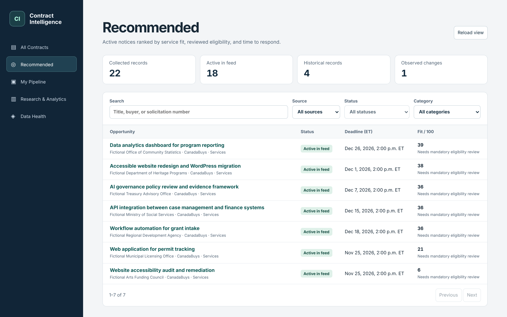
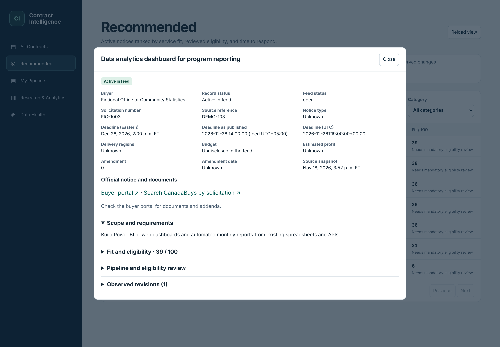
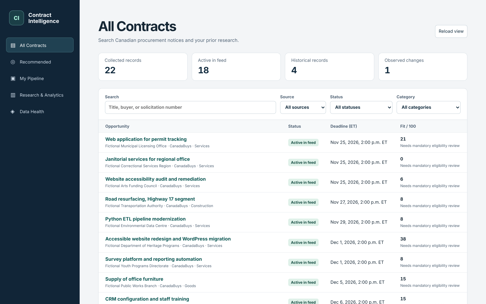

# Contract Intelligence

**Finds the Canadian government contracts worth bidding on, so a small software shop stops scrolling through hundreds of irrelevant tenders.** It downloads the official CanadaBuys tender feeds every six hours, keeps every revision, ranks each notice against the services you actually offer, and blocks anything you can't legally bid on from the shortlist.

`980+ real CanadaBuys notices verified in one import` · `refreshes every 6 h, full change history` · `75 automated tests` · `Python standard library + SQLite, zero dependencies` · `no paid services`



<sub>Screenshots use fictional notices so no live tender or bidding decision is shown. The live system runs on real CanadaBuys open data.</sub>

## What it does

| | |
|---|---|
| **Collect** | Downloads the official CanadaBuys Open and New tender CSVs on a Windows scheduled task, with retries and no overlapping runs. A replay of the same snapshot adds no duplicates. |
| **Track changes** | Every material change (deadline moved, amendment, status) is stored as a new revision, so you can see what changed and when. A notice that disappears from the feed is never assumed cancelled. |
| **Rank** | Scores fit (up to 65), time to respond (15), delivery complexity (10) and economics (10). Every point is explained, with the matching terms shown. |
| **Protect decisions** | Mandatory criteria (references, security, insurance, prequalified supply arrangements) start as *unknown*. A failed criterion or a no-bid decision removes a notice from the shortlist, and a changed source record forces a re-review. |
| **Review** | A local browser dashboard: search and filters, contract details with official links, a saved pipeline (Saved, Evaluating, Bid, No bid), analytics by buyer and category, and a data-health page. |

| Contract detail with revision history | Full register with prior research kept separate |
|---|---|
|  |  |

## Measured, not assumed

- **Ranking benchmark on 20 real notices** ([benchmarks/CI-02.md](benchmarks/CI-02.md)). Expected labels were committed *before* comparing. Recommended notices with a documented restricted bid route dropped from **3 to 0** after the fix, and no notice was ever labelled eligible without evidence.
- **Import verification.** A November 2026 import loaded 984 distinct official notices from 944 Open and 42 New rows. Replaying it added no duplicate records or versions ([SOURCES.md](SOURCES.md)).
- **Source expansion pilots** for Quebec SEAO and other non-federal sources are documented under [docs/pilots](docs/pilots), including the cases where a source was *not* safe to automate.

## How it fits into a larger automation

In my own setup, a separate scheduled worker sends a review digest from this database to n8n, where workflows deduplicate reports, score each opportunity for business fit and build a daily shortlist. Those n8n workflows aren't part of this repository. This repo is the collection, history and review core.

## Quick start

Python 3.11 or later. No packages to install.

```powershell
git clone <this repo>
cd contract-intelligence
py -3 -m ci --db data/demo.sqlite3 demo     # fictional sample data
py -3 -m ci --db data/demo.sqlite3 serve --port 8766
```

Open <http://127.0.0.1:8766>. To collect live CanadaBuys data instead, run `.\refresh.ps1` and then `.\start.ps1` (dashboard on <http://127.0.0.1:8765>). Run the tests with `py -3 -m unittest discover -s tests -v`.

The server only listens on the loopback address and has no sign-in, so keep it on your own machine.

## Working with the directory

- **All Contracts** searches titles, buyers, solicitation and source identifiers, descriptions and feed metadata. Filter by source, status or category.
- **Recommended** ranks active feed records with service matches. A failed mandatory criterion or a no-bid decision removes a notice from the shortlist. Fully reviewed notices appear first, followed by notices requiring review and partner routes. Known RFI, advance award and directed-contract types stay in the directory.
- **Contract Details** links to the buyer portal, official CanadaBuys notice or search, and the attachment URLs available in the feed. It shows buyer, deadline, scope, budget, review evidence and observed revisions.
- **My Pipeline** stores Saved, Evaluating, Bid and No bid decisions locally. Open a contract and expand **Pipeline and eligibility review** to add evidence, costs and notes. The form records local decisions.
- **Research & Analytics** summarizes the collected corpus by publication month, buyer, procurement category, first reported industry or commodity, and known budget. Use the historical filter to explore prior notices. Category totals can overlap.
- **Data Health** shows coverage, source publication times, successful downloads, errors and row counts. Use it to check the latest run even when the server was closed during refresh.

## How ranking works

The keyword profile reflects a small software consultancy's services in web and CMS, workflows and integrations, analytics, accessibility and UX, and AI governance. Title matches receive more weight than scope mentions. Fit contributes up to 65 points, response time up to 15, reviewed delivery complexity and capacity up to 10, and estimated economics up to 10. Each component and its matching terms are visible in the details.

Review mandatory bidder qualifications, experience, references, insurance, security, remote delivery and capacity against the tender documents. The app treats every unreviewed criterion as unknown. Use **Partner possible** when a permitted teaming route still requires verification, and **Not applicable** when the source supports that determination. Supply an explanation for each reviewed criterion. A changed source record requires the criteria and estimates to be reconfirmed. Pipeline notes and decisions remain visible. Estimated profit is owner-entered estimated revenue less estimated cost. A recorded ceiling affects the economics score when both estimates are available. A tender budget alone earns no profitability points.

## Keep the database current

The setup machine runs **Contract Intelligence - CanadaBuys refresh** in Windows Task Scheduler every six hours while the current user is signed in. The task refreshes both feeds independently, retries failures and skips overlapping scheduled instances. It runs independently of the dashboard. Inspect it with:

```powershell
Get-ScheduledTaskInfo -TaskName 'Contract Intelligence - CanadaBuys refresh'
Start-ScheduledTask -TaskName 'Contract Intelligence - CanadaBuys refresh'
```

On another Windows machine, run `.\install-refresh-task.ps1` once to install and start the same per-user task. Edit or disable it in Task Scheduler. To refresh from an open terminal instead, use `py -3 -m ci watch --feed all --interval-hours 6`. The local task records refresh results in SQLite.

## Data and verification

- **Active in feed** means the record was present in an applicable official snapshot published within 48 hours, the source reported `Open`, and the normalized deadline is in the future. Check the buyer notice and addenda before acting.
- **Historical** includes passed deadlines, explicit terminal statuses and prior manual research. A missing, stale, undated or locally imported open record requires a source recheck. A missing record alone does not establish cancellation.
- **Fictional demo** uses the `demo:` namespace. To try it without changing the main directory, run `py -3 -m ci --db data/demo.sqlite3 demo` and `py -3 -m ci --db data/demo.sqlite3 serve --port 8766`.

The November 10, 2026 verification imported 984 distinct official notices from 944 Open rows and 42 New rows. Replays added no duplicate records or versions. See [schema, verification and expansion roadmap](SOURCES.md) for the source evidence and coverage limits.

```powershell
py -3 -m unittest discover -s tests -v
```

The SQLite database lives at `data/contracts.sqlite3`. Keep the database, snapshots, owner evidence and notes out of Git. The current architecture is local Python and SQLite with no paid services. If shared access eventually becomes necessary, evaluate authenticated access and PostgreSQL after measuring concurrency and storage needs. No hosting is required for the current workflow.

## Check email-alert source coverage

The **Data Health** page compares a sanitized, dated 10-notice cohort from TenderPipe, Bids & Tenders and SAP Business Network against the existing SQLite notices. It is a read-only audit, not an email connection or a new collector. The fixture `fixtures/email_alerts_2026-11-12.json` contains only tender metadata, not message bodies or account data.

Run against the **existing local database**:

```powershell
py -3 -m ci --db data/contracts.sqlite3 email-audit --out data/email-coverage-audit.json
```

The command opens SQLite in read-only mode, failing if the database is absent. The report under `data/` stays out of Git. Restart the dashboard after updating your checkout to see the comparison in **Data Health**.

Outcomes: `FOUND_IN_FEDERAL_FEED` = exact federal reference match; `FOUND_IN_OTHER_SOURCE` = exact local manual/non-federal record but not proof of automated coverage; `POSSIBLE_MATCH_REVIEW` = title/hint suggestion not counted as an exact match; `NOT_FOUND_IN_LOCAL_FEDERAL` = missing from this local snapshot pending further investigation; `OUTSIDE_AUTOMATED_SCOPE` = non-federal notice not imported by the federal feed.

To audit another sanitized JSON cohort use `--alerts path/to/file.json`; required fields per record are platform, reference, title, buyer and scope (`federal` or `non_federal`). Supplier email dates, notice types and buyer eligibility remain unverified until checked against official buyer pages. Ten alerts cannot establish countrywide recall. A scheduled Gmail/n8n email adapter is not enabled.

## Back up and restore local research

Create a timestamped snapshot while the dashboard or refresh task is running. The backup includes saved pipeline decisions, notes and reviews. Store copies in a private, access-controlled location outside Git.

```powershell
$stamp = Get-Date -Format 'yyyyMMdd-HHmmss'
py -3 -m ci.backup data/contracts.sqlite3 "data/backups/contracts-$stamp.sqlite3"
```

To check recovery, select a backup, restore it to a new file, and inspect it in a separate dashboard. Refresh continues to use the main database.

```powershell
py -3 -m ci.backup "data/backups/contracts-$stamp.sqlite3" data/recovered.sqlite3
py -3 -m ci --db data/recovered.sqlite3 serve --port 8766
```

Open [the recovery dashboard](http://127.0.0.1:8766), then check **My Pipeline** and one saved review. The copy command validates integrity and refuses to overwrite existing files. To make a recovered copy your working database, point your dashboard and refresh command at it with `--db` before the command name.
